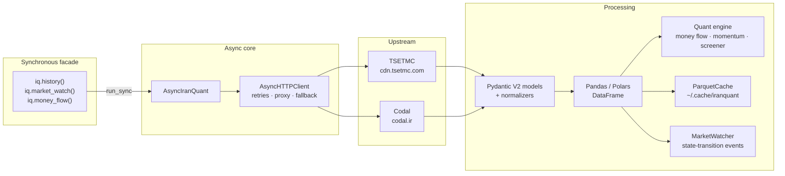

# iranquant

[](https://pypi.org/project/iranquant/)


Async-first **TSETMC / Codal** market-data client for the Iranian capital market.
It also exposes a synchronous API and returns Pandas or Polars frames. Includes
Codal table reconstruction, quant analytics and a market watcher.

- **Documentation site** — built with MkDocs Material: `pip install -e ".[docs]" && mkdocs serve`
- **Quickstart** — [`docs/quickstart.md`](docs/quickstart.md)
- **API reference** — [`docs/reference/top-level.md`](docs/reference/top-level.md)
- **راهنمای فارسی** — [پایین همین صفحه](#فارسی)

---

## Features

| | |
|---|---|
| **Async and sync** | Every call has an `async` implementation and a module-level synchronous wrapper. The sync bridge works inside Jupyter/Colab event loops. |
| **Pandas and Polars** | `engine="pandas"` or `engine="polars"` returns the same columns and types for either engine. |
| **Validated payloads** | Pydantic V2 models validate upstream responses; invalid data raises `ParseError` instead of producing a partial frame. |
| **Codal tables** | Extracts the `var datasource` payload and reconstructs each sheet and table into DataFrames. |
| **Monthly sales** | Locates the production and sales table, extracts month/YTD/prior-year values, and computes MoM/YoY growth. |
| **Quant analytics** | Smart-money flow, ZigZag swing legs, signed multi-timeframe movement power and a vectorized screener. |
| **Streaming events** | `MarketWatcher` turns consecutive MarketWatch snapshots into queue-lock, queue-break and volume-spike events. |
| **CLI** | `iranquant search`, `history`, `screener`, `indices` and `codal --parse-latest` with Rich tables. |

## Architecture



## Architecture Overview

| Module | Scope | Key Capabilities |
| :--- | :--- | :--- |
| `iranquant.market` | TSETMC Market Data | Historical OHLCV, backward price adjustment (`all`, `capital`, `cash`), client-type (Haghighi/Hoghooghi), live MarketWatch, 5-level order book, intraday trades, and market/sector indices |
| `iranquant.codal` | Codal Announcements & Parser | Paginated letter search, HTML `datasource` extraction without fragile DOM scraping, multi-table reconstruction, and automated monthly sales MoM/YoY analysis |
| `iranquant.quant` | Quantitative Analytics | Smart-money flow, buyer-power ratios, movement-power scoring, multi-timeframe swing-leg detection, and vectorized buy/sell queue screeners |
| `iranquant.stream` | Event-Driven Polling | Async `MarketWatcher` with market-hours awareness (Saturday–Wednesday, 08:45–12:30 IRST) and callback hooks |
| `iranquant.core` | Transport & Storage | Async `httpx` client with retry backoff, Persian text/digit normalizer, Pandas/Polars dual-engine builder, and local Parquet caching |

---

## English

### Installation

```bash
pip install iranquant
```

From a checkout (development extras):

```bash
python -m venv .venv && source .venv/bin/activate
pip install -e ".[dev]"
```

Documentation toolchain:

```bash
pip install -e ".[docs]"
mkdocs serve          # http://127.0.0.1:8000
mkdocs build --strict
```

### Command-line interface

Installing the package also installs the `iranquant` command:

```bash
iranquant search فولاد
iranquant history فولاد --days 15 --adjust all
iranquant screener --mode buy-queue --limit 20
iranquant screener --mode sell-queue
iranquant screener --mode tick-surge --limit 10
iranquant indices
iranquant codal فولاد --parse-latest
```

- `search` prints a table of matching tickers, company names, `insCode` and market flow.
- `history` merges `full_history`, money flow and movement power into a color-coded table
  (daily return, buyer power, smart-money flags and movement score).
- `screener` applies `MarketScreener` to a live MarketWatch snapshot.
- `indices` lists the overall, equal-weight and sector indices.
- `codal --parse-latest` lists monthly letters, then prints the newest report's tables and
  a monthly sales summary panel (million Rials, YoY growth).

### Quickstart (synchronous)

```python
import iranquant as iq

# Daily OHLCV, backward-adjusted for dividends and capital increases
df = iq.history("فولاد", adjust="all")
print(df.tail())

# Full history merged with real/legal client-type data
full = iq.full_history("فولاد")

# Live market-wide snapshot (one request)
market = iq.market_watch()

# Resolve a symbol to its TSETMC insCode
code = iq.get_inscode("فولاد")   # "46348559193224090"

# Best-limit order book (5 levels)
book = iq.order_book("فولاد")

# Intraday OHLCV bars: time, open, high, low, close, volume
trades = iq.intraday_trades("فولاد")

# Live indices: index_code, name, index_value, change, change_pct
indices = iq.indices_live()
```

### Quickstart (asynchronous)

```python
import asyncio
import iranquant as iq

async def main() -> None:
    async with iq.AsyncIranQuant() as client:
        df = await client.history("فولاد")
        print(df.head())

asyncio.run(main())
```

### Using Polars

```python
import iranquant as iq

df = iq.history("فولاد", engine="polars")
print(type(df))  # <class 'polars.dataframe.frame.DataFrame'>

flow = iq.money_flow("فولاد", engine="polars")
print(flow.filter(flow["smart_money_entry"]).height)
```

### DataFrame reference

#### `history()` — 11 columns, one row per trading day

| Column | Type | Description |
|---|---|---|
| `date` | `datetime.date` | Gregorian trading date. |
| `jdate` | `str` | Jalali date (`YYYY-MM-DD`). |
| `open` | `float` | Opening price. |
| `high` | `float` | Daily high. |
| `low` | `float` | Daily low. |
| `close` | `float` | Last traded price. |
| `final_price` | `float` | Official closing price. |
| `prev_price` | `float` | Previous close. |
| `volume` | `float` | Traded shares. |
| `value` | `float` | Traded value in Rials. |
| `trades` | `float` | Number of trades. |

Adjustment modes: `adjust="all"` (dividends + capital increases, default),
`adjust="capital_only"` (ex-rights only), `adjust="none"` (raw).

#### `client_type()` — 14 columns

`date`, `jdate`, then `buy_I_Volume`, `buy_N_Volume`, `buy_I_Value`,
`buy_N_Value`, `buy_N_Count`, `buy_I_Count`, `sell_I_Volume`, `sell_N_Volume`,
`sell_I_Value`, `sell_N_Value`, `sell_N_Count`, `sell_I_Count`.

`I` = individual/retail (حقیقی), `N` = institutional/legal (حقوقی).

#### `full_history()` — 23 columns

The 11 `history()` columns outer-joined with the 12 client-type volume/value/count
columns on `date`.

#### `search()` — 9 columns

| Column | Type | Description |
|---|---|---|
| `ins_code` | `str` | TSETMC instrument code. |
| `symbol` | `str` | Persian ticker. |
| `company_name` | `str` | Company name. |
| `isin` | `str` | ISIN. |
| `shares` | `float` | Listed shares. |
| `flow` | `int` | Market flow (1/2/4 active). |
| `board` | `str` | Board code. |
| `last_date` | `datetime.date \| None` | Last trade date. |
| `last_date_jdate` | `str \| None` | Last trade date in Jalali. |

#### `market_watch()` — 18 columns

`ins_code`, `symbol`, `company_name`, `eps`, `pe`, `open`, `high`, `low`, `close`,
`final_price`, `prev_price`, `volume`, `value`, `trades`, `tmax`, `tmin`,
`total_shares`, `order_book` (`list[dict[str, float]]`).

#### `order_book()` — 7 columns

`n` (level 1–5), `qmd`/`zmd`/`pmd` (bid quantity/order count/price),
`pmo`/`zmo`/`qmo` (ask price/order count/quantity).

#### `intraday_trades()` — 6 columns

`time` (`datetime.time`), `open`, `high`, `low`, `close`, `volume`.

#### `indices_live()` / `index_history()` — standardized columns

`index_code`, `name`, `index_value`, `change`, `change_pct`, `date`, `jdate`,
`time`. The overall and equal-weight rows additionally expose `market_state` and
`market_state_title`; sector rows keep their raw fields.

### Codal reports

```python
import iranquant as iq

reports = iq.monthly_reports("فولاد")          # گزارش فعالیت ماهانه
print(reports.Total, len(reports.Letters))

letter = reports.Letters[0]
tables = iq.codal_report(letter)               # URLs are resolved automatically

for name, table in tables.items():
    print(name, table.shape)                   # "sheet - table"

# Raw search; LetterType 58 = monthly, 6 = financial statements
everything = iq.codal_search("فولاد", letter_type=-1, page=1)
statements = iq.financial_statements("فولاد")

# Same parser, exposed directly at the top level
tables = iq.parse_codal_report(letter, engine="pandas")
```

`CodalSearchResponse` behaves like a small collection and can be exported to a DataFrame:

```python
reports = iq.monthly_reports("فولاد")

len(reports)                    # letters on this page
reports.total                   # total matches across all pages
reports[0].Title                # first letter
for letter in reports.letters:  # iterate
    print(letter.TracingNo)
frame = reports.to_dataframe()  # or engine="polars"
```

#### Monthly sales analyzer

`monthly_sales_summary` fetches the newest monthly report, locates the
`تولید و فروش` table, extracts month/year-to-date/prior-year values and compares
the current month against the previous distinct monthly report:

```python
import iranquant as iq

summary = iq.monthly_sales_summary("فولاد")

print(summary["period_end"])           # "1405-07-30"
print(summary["current_month_sales"])  # million Rials
print(summary["ytd_sales"])
print(summary["prev_ytd_sales"])
print(summary["mom_change_pct"])       # Month-over-Month %
print(summary["yoy_change_pct"])       # Year-over-Year %
print(summary["summary_df"])           # جمع / جمع فروش داخلی / ...
```

The lower-level `iq.analyze_monthly_sales(tables)` accepts any table mapping
produced by `parse_codal_report` and returns the same numeric keys plus
`summary_df`.

### Quant analytics

```python
import iranquant as iq
from iranquant import compute_money_flow, compute_movement_power, detect_swing_legs

# Fetch + compute in one call
flow = iq.money_flow("فولاد")
power = iq.movement_power("فولاد")

print(flow[["jdate", "buyer_power_ratio", "smart_money_entry"]].tail())
print(power[["jdate", "er_5", "er_20", "movement_power_score"]].tail())

# Lower-level, engine-agnostic helpers
full = iq.full_history("فولاد")
legs = detect_swing_legs(full, reversal_pct=5.0)
print(legs[["direction", "start_date", "end_date", "leg_return_pct"]])
```

#### `money_flow()` — 11 added columns

| Column | Type | Description |
|---|---|---|
| `real_buy_per_capita` | `float` | Rials per retail buy order. |
| `real_buy_per_capita_m` | `float` | Same, million Tomans. |
| `real_sell_per_capita` | `float` | Rials per retail sell order. |
| `real_sell_per_capita_m` | `float` | Same, million Tomans. |
| `buyer_power_ratio` | `float` | Real buy/sell per-capita ratio. |
| `net_real_value` | `float` | Net real money flow in Rials. |
| `ownership_change_pct` | `float` | Net real volume / total volume. |
| `close_vs_final_pct` | `float` | Last price vs official close. |
| `vol_ratio` | `float` | Volume vs its rolling mean. |
| `smart_money_entry` | `bool` | Accumulation signal. |
| `smart_money_exit` | `bool` | Distribution signal. |

Signals: `entry` requires `vol_ratio >= 1.8`, `buyer_power_ratio >= 1.5`,
`net_real_value > 0` and `close >= final_price`; `exit` mirrors them at
`0.67`, negative flow and `close <= final_price`.

#### `movement_power()` — per-window `er_<w>` + score

| Column | Type | Description |
|---|---|---|
| `er_5`, `er_20`, `er_60` | `float` | Signed Kaufman efficiency ratio per window. |
| `movement_power_score` | `float` | `0.5·er_5 + 0.3·er_20 + 0.2·er_60`, then volume/buyer-power adjusted and clipped. |

#### `detect_swing_legs()` — 11 columns

`leg_id`, `direction` (`int`: `1` up, `-1` down), `start_date`, `end_date`, `start_price`,
`end_price`, `leg_return_pct`, `leg_bars`, `leg_velocity`, `avg_volume`,
`leg_volume_expansion`.

### Screener over a live snapshot

```python
import iranquant as iq

market = iq.market_watch()
screener = iq.IranQuant().screener(market)     # or MarketScreener(market)

buy_queues = screener.filter_buy_queue()
sell_queues = screener.filter_sell_queue()
surges = screener.filter_positive_tick_surge(min_diff_pct=1.5)

high_volume = screener.scan_market(lambda df: df["volume"] > df["volume"].median())
```

### Live streaming

```python
import asyncio
from iranquant import MarketWatcher
from iranquant.stream import BUY_QUEUE_LOCKED, VOLUME_SPIKE

async def main() -> None:
    watcher = MarketWatcher()

    @watcher.on_event(BUY_QUEUE_LOCKED)
    def on_lock(event):
        print("buy queue locked:", event.symbol)

    @watcher.on_event(VOLUME_SPIKE)
    async def on_spike(event):
        print("volume spike:", event.symbol, event.data)

    async for event in watcher.watch(
        interval=3.0,
        symbols=["فولاد", "خودرو"],
        only_market_hours=True,   # Sat–Wed, 09:00–12:30 Tehran
    ):
        print(event.timestamp, event.event_type, event.symbol)

asyncio.run(main())
```

| Event | Trigger |
|---|---|
| `BUY_QUEUE_LOCKED` | `close >= tmax` with visible buy-queue volume. |
| `BUY_QUEUE_BROKEN` | A previously locked buy queue clears. |
| `SELL_QUEUE_LOCKED` | `close <= tmin` with visible sell-queue volume. |
| `SELL_QUEUE_BROKEN` | A previously locked sell queue clears. |
| `VOLUME_SPIKE` | Per-poll volume delta ≥ 1.8× the recent average. |

### Parquet caching

```python
import iranquant as iq
from iranquant.core.cache import ParquetCache

cache = ParquetCache()                 # ~/.cache/iranquant
path = cache.save("فولاد", iq.history("فولاد"))

# Incremental: fetch fresh data, append only unseen dates
latest = iq.history("فولاد")
cache.update("فولاد", latest)
cached = cache.load("فولاد")
```

### Network / proxy notes

- Environment proxies are **ignored by default** (`trust_env=False`), which avoids
  domestic `.ir` traffic being routed through HTTP proxy ports.
- Pass `proxy=` explicitly to opt in:

```python
async with AsyncIranQuant(proxy="http://127.0.0.1:9090") as client:
    ...
```

- On `ssl.SSLError` / `ConnectError`, requests to `*.tsetmc.com` are retried once
  over an insecure HTTP/1.1 transport; `*.codal.ir` always uses its own
  verification-relaxed transport.

### Error handling

```python
import iranquant as iq

try:
    df = iq.history("نماد_ناموجود")
except iq.SymbolNotFoundError:
    ...   # symbol could not be resolved to an insCode
except iq.NetworkError:
    ...   # upstream unreachable / timed out after retries
except iq.ParseError:
    ...   # payload was reachable but structurally unexpected
```

All errors inherit from `iranquant.IranQuantError`.

### Development

```bash
pytest -q
ruff check src tests examples
ruff format --check src tests examples
mypy src tests
mkdocs build --strict

# Live integration test (needs direct access to cdn.tsetmc.com)
IRANQUANT_LIVE=1 pytest tests/test_live_integration.py -m live -q
```

Runnable scripts live in [`examples/`](examples/): history plus quant analytics,
live market screening, and Codal monthly sales analysis.

### License

[MIT](LICENSE) © iranquant contributors

---

<div dir="rtl" markdown="1">

## فارسی

### iranquant چیست؟

`iranquant` یک کتابخانهٔ **ناهمگام (async)** برای دریافت دادهٔ بازار سرمایهٔ ایران از
**TSETMC** و **کدال** است. یک API همگام (sync) ساده نیز ارائه می‌شود تا در اسکریپت‌ها و
محیط‌های Jupyter/Colab بدون خطای event loop کار کند. خروجی می‌تواند **Pandas** یا **Polars** باشد.

مستندات کامل (انگلیسی) با MkDocs Material ساخته می‌شود:

```bash
pip install -e ".[docs]"
mkdocs serve
```

### نصب

```bash
pip install iranquant
```

### نمونهٔ سریع

```python
import iranquant as iq

# تاریخچهٔ روزانه با تعدیل کامل (سود نقدی و افزایش سرمایه)
df = iq.history("فولاد", adjust="all")

# تاریخچهٔ کامل همراه با دادهٔ حقیقی/حقوقی
full = iq.full_history("فولاد")

# عکس لحظه‌ای کل بازار (یک درخواست)
market = iq.market_watch()

# کد نماد (insCode)
code = iq.get_inscode("فولاد")   # "46348559193224090"

# دفتر سفارش (۵ سطح)
book = iq.order_book("فولاد")

# کندل‌های درون‌روزی: زمان، باز، بیشینه، کمینه، بسته، حجم
trades = iq.intraday_trades("فولاد")

# شاخص‌های زنده: index_code، name، index_value، change، change_pct
indices = iq.indices_live()
```

### نسخهٔ ناهمگام

```python
import asyncio
import iranquant as iq

async def main() -> None:
    async with iq.AsyncIranQuant() as client:
        df = await client.history("فولاد")
        print(df.head())

asyncio.run(main())
```

### خروجی Polars

```python
import iranquant as iq

df = iq.history("فولاد", engine="polars")
flow = iq.money_flow("فولاد", engine="polars")
print(flow.filter(flow["smart_money_entry"]).height)
```

### ستون‌های خروجی تاریخچه

`date`، `jdate`، `open`، `high`، `low`، `close`، `final_price`، `prev_price`،
`volume`، `value`، `trades`.

حالت‌های تعدیل: `adjust="all"` (سود نقدی + افزایش سرمایه، پیش‌فرض)،
`adjust="capital_only"` (فقط افزایش سرمایه) و `adjust="none"` (خام).

`full_history()` همان ۱۱ ستون را با ۱۲ ستون دادهٔ حقیقی/حقوقی (`buy_I_Volume`،
`buy_N_Volume`، `buy_I_Value`، `buy_N_Value`، `buy_N_Count`، `buy_I_Count` و
معادل‌های `sell_*`) روی تاریخ ادغام می‌کند.

### گزارش‌های کدال

```python
import iranquant as iq

reports = iq.monthly_reports("فولاد")   # گزارش فعالیت ماهانه
letter = reports.Letters[0]
tables = iq.codal_report(letter)        # همهٔ جدول‌های گزارش

for name, table in tables.items():
    print(name, table.shape)            # «شیت - جدول»

statements = iq.financial_statements("فولاد")

# تحلیل خودکار فروش ماهانه
summary = iq.monthly_sales_summary("فولاد")
print(summary["current_month_sales"])
print(summary["mom_change_pct"], summary["yoy_change_pct"])
print(summary["summary_df"])
```

### خط فرمان (CLI)

```bash
iranquant search فولاد
iranquant history فولاد --days 15
iranquant screener --mode buy-queue --limit 20
iranquant indices
iranquant codal فولاد --parse-latest
```

### تحلیل‌های کمی

```python
import iranquant as iq
from iranquant import detect_swing_legs

flow = iq.money_flow("فولاد")           # جریان پول هوشمند
power = iq.movement_power("فولاد")      # قدرت حرکت چندبازه‌ای

print(flow[["jdate", "buyer_power_ratio", "smart_money_entry"]].tail())
print(power[["jdate", "er_5", "er_20", "movement_power_score"]].tail())

legs = detect_swing_legs(iq.full_history("فولاد"), reversal_pct=5.0)
```

- `buyer_power_ratio`: نسبت قدرت خرید حقیقی به فروش حقیقی.
- `smart_money_entry`: وقتی `vol_ratio >= 1.8` و `buyer_power_ratio >= 1.5` و
  جریان پول حقیقی مثبت و `close >= final_price` باشد.
- `smart_money_exit`: قرینهٔ ورود با آستانهٔ `0.67`.
- `movement_power_score`: ترکیب وزنی `er_5`، `er_20` و `er_60` با تعدیل حجم و
  قدرت خریدار.

### فیلتر بازار

```python
import iranquant as iq

market = iq.market_watch()
screener = iq.IranQuant().screener(market)

buy_queues = screener.filter_buy_queue()
sell_queues = screener.filter_sell_queue()
surges = screener.filter_positive_tick_surge(min_diff_pct=1.5)
```

### پخش زندهٔ بازار

```python
import asyncio
from iranquant import MarketWatcher
from iranquant.stream import BUY_QUEUE_LOCKED, VOLUME_SPIKE

async def main() -> None:
    watcher = MarketWatcher()

    @watcher.on_event(BUY_QUEUE_LOCKED)
    def on_lock(event):
        print("صف خرید قفل شد:", event.symbol)

    @watcher.on_event(VOLUME_SPIKE)
    async def on_spike(event):
        print("جهش حجم:", event.symbol, event.data)

    async for event in watcher.watch(
        interval=3.0,
        symbols=["فولاد", "خودرو"],
        only_market_hours=True,   # شنبه تا چهارشنبه، ۹:۰۰ تا ۱۲:۳۰ تهران
    ):
        print(event.timestamp, event.event_type, event.symbol)

asyncio.run(main())
```

رویدادها: `BUY_QUEUE_LOCKED`، `BUY_QUEUE_BROKEN`، `SELL_QUEUE_LOCKED`،
`SELL_QUEUE_BROKEN` و `VOLUME_SPIKE`.

### کش Parquet

```python
import iranquant as iq
from iranquant.core.cache import ParquetCache

cache = ParquetCache()                 # ~/.cache/iranquant
cache.save("فولاد", iq.history("فولاد"))
cache.update("فولاد", iq.history("فولاد"))   # فقط ردیف‌های جدید
cached = cache.load("فولاد")
```

### نکتهٔ شبکه و پروکسی

به‌صورت پیش‌فرض متغیرهای محیطی پروکسی نادیده گرفته می‌شوند
(`trust_env=False`) تا ترافیک دامنه‌های داخلی از پروکسی HTTP عبور نکند.
برای استفادهٔ آگاهانه از پروکسی:

```python
async with iq.AsyncIranQuant(proxy="http://127.0.0.1:9090") as client:
    ...
```

در صورت خطای `ssl.SSLError` یا `ConnectError`، درخواست‌های `*.tsetmc.com` یک بار
روی ترانسپورت ناامن HTTP/1.1 دوباره تلاش می‌شوند و `*.codal.ir` همیشه از
ترانسپورت مخصوص خود استفاده می‌کند.

### خطاها

```python
import iranquant as iq

try:
    df = iq.history("نماد_ناموجود")
except iq.SymbolNotFoundError:
    ...
except iq.NetworkError:
    ...
except iq.ParseError:
    ...
```

همهٔ خطاها از `iranquant.IranQuantError` ارث‌بری می‌کنند.

### توسعه و تست

```bash
pytest -q
ruff check src tests examples
ruff format --check src tests examples
mypy src tests
```

### مجوز

MIT

</div>
