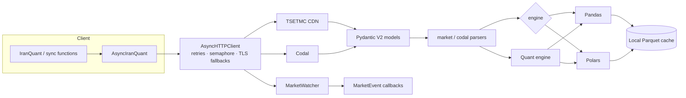

# iranquant

**Async-first TSETMC + Codal market-data client for the Iranian capital market.**

`iranquant` uses the same JSON endpoints as the TSETMC web terminal and
reconstructs Codal's embedded `var datasource` tables into DataFrames. It
provides a synchronous API for scripts and an async API for production
services, with Pandas or Polars output, a quant analytics engine and a market
watcher.

```python
import iranquant as iq

frame = iq.history("فولاد", adjust="all")
print(frame.tail())
```

## Capabilities

| Area | Description |
| --- | --- |
| **Async and sync** | One pooled `httpx` transport with retries, a concurrency semaphore and TLS fallbacks. The sync wrapper works inside Jupyter/Colab event loops. |
| **Codal parsing** | Tables are read from the raw `var datasource = {...}` JSON with a brace-balanced parser; no HTML selectors are involved. |
| **Pydantic V2** | Wire payloads are validated by models that tolerate fields added by TSETMC. |
| **Pandas and Polars** | Every public function accepts `engine="pandas"` (default) or `engine="polars"` and returns that engine type. |
| **Price adjustment** | Backward gap-ratio adjustment (`adjust="all"`) and ex-rights capital-increase adjustment (`adjust="capital_only"`). |
| **Quant analytics** | Buyer power, per-capita values, smart-money entry/exit, multi-timeframe Kaufman efficiency, ZigZag swing legs and a vectorized screener. |
| **Monthly sales** | Extracts current-month, YTD and prior-year sales from the standard تولید و فروش table and computes MoM/YoY growth. |
| **CLI** | `iranquant search`, `history`, `screener`, `indices` and `codal --parse-latest`, rendered with Rich tables. |
| **Watcher** | MarketWatch polling with `BUY_QUEUE_LOCKED`, `BUY_QUEUE_BROKEN`, `SELL_QUEUE_LOCKED`, `SELL_QUEUE_BROKEN` and `VOLUME_SPIKE` events. |
| **Networking** | Environment proxies are ignored by default; `*.codal.ir` uses a certificate-relaxed transport and TSETMC gets an HTTP/1.1 no-verify fallback. |

## Architecture



## Installation

```bash
pip install iranquant
```

From a checkout:

```bash
python -m venv .venv && source .venv/bin/activate
pip install -e ".[dev,docs]"
```

Requirements: Python 3.10+, `httpx`, `pydantic>=2.7`, `tenacity`,
`jdatetime`, `pandas`, `polars` and `pyarrow`.

## Quick example

```python
import iranquant as iq

code = iq.get_inscode("فولاد")                       # "46348559193224090"
daily = iq.history(code, adjust="all")              # 11 clean OHLCV columns
full = iq.full_history("فولاد")                     # + real/legal client data
market = iq.market_watch()                          # one request, whole market
flow = iq.money_flow("فولاد")                       # smart-money columns
```

Use Polars anywhere with `engine="polars"`:

```python
daily = iq.history("فولاد", engine="polars")
print(type(daily))  # <class 'polars.dataframe.frame.DataFrame'>
```

## Next steps

- **[Quickstart](quickstart.md)** — a five-minute sync and async tutorial,
  including proxy and split-tunneling tips for Iran.
- **[Market Data](guide/market.md)** — symbols, adjusted history, MarketWatch,
  order books, intraday bars and indices.
- **[Codal Reports](guide/codal.md)** — announcement search and table
  reconstruction.
- **[Quant Analytics](guide/quant.md)** — exact formulas for money flow,
  movement power and swing legs.
- **[Streaming](guide/streaming.md)** — the `MarketWatcher` event loop.
- **[Caching & Polars](guide/caching-and-polars.md)** — incremental Parquet
  caching.
- **[API Reference](reference/top-level.md)** — every public symbol.
- **[راهنمای فارسی](fa/index.md)** — راهنمای کامل فارسی.
